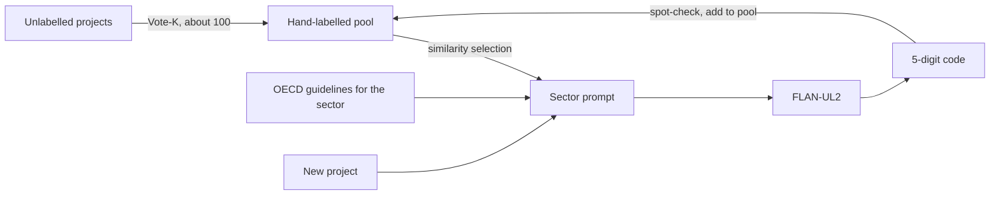

# OECD purpose-code classifier

This repo packages the method I ran at AidData in 2023. It reads a development-finance project's title and description and assigns its 5-digit OECD purpose code, using FLAN-UL2 on AWS SageMaker with a few coded examples in the prompt. I rewrote it from my 2023 drafts as a small Python package.

## The problem

Every aid project carries a 3-digit sector code, such as 122 for basic health. The 5-digit purpose code underneath it, such as 12262 for malaria control, says what the money is for. Research assistants coded those by hand, which was slow and costly. Most sectors also had no labelled data to train a model on.

## The method

1. Write one prompt per sector. The project's 3-digit code picks the guidelines. The instruction lists only the 5-digit codes under that sector, with the official OECD clarifications.
2. Choose the examples. I add k already-coded projects to the prompt as input and answer pairs. The best setting takes the k most similar ones by SBERT embedding (Liu et al., 2021). Random and hand-picked examples also work, and the order can be reversed.
3. Ask the model. FLAN-UL2 answers from the prompt alone. There is no fine-tuning, so one set of weights serves every sector. An answer that is not a valid 5-digit code for that sector is marked unparsed and left for a person.
4. Build the example pool. Where nothing is labelled yet, Vote-K (Su et al., 2022) picks a small diverse set of projects to hand-label.



## Results

These are the figures from my 2023 work on AidData's health-sector projects. That data is private and this repo ships none, so I have not re-run the numbers here.

| Setup | Accuracy |
| :--- | ---: |
| Zero-shot | 88% |
| Hand-picked examples, k=5 | 92% |
| Hand-picked examples, k=7 | 95% |
| SBERT similarity, k=5, 8 and 10 | above 96% on average, best 96.84% at k=10 |

With Vote-K, I needed about 100 hand-labelled examples instead of about 1,000, and accuracy held against a 1,000-record benchmark.

## How to use it

Install with `pip install -e ".[sbert,aws]"`. You need two CSV files.

- Unlabelled projects: `title`, `description`, `code3`.
- Labelled pool: `title`, `description`, `code5`, and an optional `id`.

Deploy the model. The dry run is the default and prints the config and the hourly price. The endpoint bills until you delete it.

```bash
python deploy/sagemaker/deploy_flan_ul2.py            # dry run
python deploy/sagemaker/deploy_flan_ul2.py --deploy
python deploy/sagemaker/deploy_flan_ul2.py --delete
```

Classify:

```bash
purpose-classify --unlabelled projects.csv --pool labelled.csv \
  --endpoint flan-ul2-purpose-coder --k 5 --output predictions.csv
```

The output keeps your columns and adds `predicted_code5`, `status`, `raw_output` and `example_ids`. To choose what to label first, run `purpose-annotate --unlabelled projects.csv --budget 100 --output to_label.csv`. The [deploy notes](deploy/sagemaker/README.md) cover the instance and the request format.

Where the 2023 drafts were silent, I picked a default and marked it in the code as not specified in the 2023 drafts. That covers the SBERT model, the Vote-K graph size and the decoding settings. FLAN-UL2's 2,048-token window limits how large k can be.

## Tech stack

Python 3.11 to 3.13, NumPy, sentence-transformers (optional), boto3, FLAN-UL2 on AWS SageMaker, pytest, ruff and GitHub Actions.
