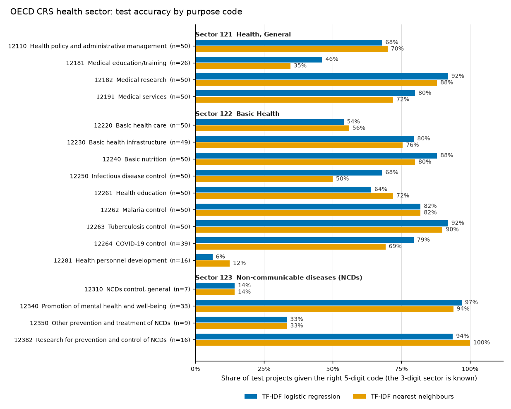

# oecd-aid-finance-llm-classifier

Classifies OECD Creditor Reporting System health-sector aid projects into 5-digit purpose codes, given the 3-digit sector. Two TF-IDF baselines are measured here: 74.1% test accuracy for the best of them. A few-shot LLM classifier built on the same split is wired in but has not been run in this repo.



## The problem

Every aid project reported to the OECD's Creditor Reporting System carries a purpose code that says what the money is for. The code has three levels. The 3-digit sector is the coarse one (121 Health, General; 122 Basic Health; 123 Non-communicable diseases). The 5-digit purpose code is the fine one (12262 Malaria control, 12263 Tuberculosis control, 12220 Basic health care, and so on). Donor agencies pick the 5-digit code themselves from the OECD's list, and the descriptions they write are free text. Checking or assigning those codes by hand is slow.

The task here follows how it was framed at AidData in 2023: the 3-digit sector is already known, and the model chooses among the 5-digit codes under it. A model that can do this well could pre-fill codes for a reviewer, or flag projects where the stated code and the text disagree.

## The solution

`python src/run_pipeline.py` does the following:

1. `src/data.py` loads a committed sample of 3,227 real CRS 2024 health-sector projects, checks its SHA-256, and splits it 60/20/20 into train, validation and test. Texts whose TF-IDF cosine similarity is 0.8 or higher always land in the same split, so no val or test text has a train text at cosine 0.8 or above under that vectoriser.
2. `src/classifiers.py` fits two baselines, a TF-IDF logistic regression and a TF-IDF nearest-neighbour vote, and predicts a 5-digit code with a confidence.
3. `src/evaluate.py` scores them on the test split: accuracy, macro-F1, per-sector and per-code accuracy, the most common confusions. It also picks an abstention threshold on validation and reports it once on test.
4. The few-shot LLM classifier (`FewShotLLM`) runs only if a Vertex AI endpoint is configured. Here none was, so the pipeline records "not run". It never fabricates or caches LLM output.
5. `results/sample_prompts.md` shows three real prompts built from the data, so you can read exactly what FLAN-UL2 would receive. `src/figure.py` draws the figure above.

The data is public: the OECD CRS 2024 flows file and the OECD's purpose-code list. Attribution, licence text, every filter count and the dropped codes are in [DATA.md](DATA.md). Only the 2.3 MB sample is committed.

## Method

- **Taxonomy.** `config/purpose_codes.json` holds the whole official code list (all sectors, with names and the OECD's descriptions), built from the OECD workbook by `scripts/build_taxonomy.py`. The prompt's code criteria come from it.
- **Sample.** `scripts/build_sample.py` keeps rows in sectors 121 to 123 whose purpose code is a 5-digit child of the sector, with a description of at least 20 words, in English by a stopword heuristic. It drops texts that carry more than one purpose code, keeps one row per distinct text, drops codes with fewer than 30 distinct texts, and caps each code at 250 rows with a fixed seed. 370,264 data lines in the bulk file become 3,227 rows over 17 codes.
- **Split.** Stratified by purpose code and grouped by near-duplicate clusters. Two texts (title plus description) are joined when their TF-IDF cosine similarity is at least 0.8 (`NEAR_DUPLICATE_COSINE` in `src/data.py`); a cluster is a connected component of that relation, so a chain of similar texts stays together, and a cluster goes to one split. CRS repeats text heavily, and a leaked duplicate inflates every score. The guarantee is specific to the vectoriser in `src/settings.py`: every val and test text has cosine below 0.8 to every train text. The highest is 0.798 (val) and 0.789 (test). Texts between about 0.6 and 0.8 can still sit on both sides. The 3,227 texts form 2,928 clusters; 2,857 are single texts and the largest has 28, so no cluster swallows a code. See [DATA.md](DATA.md).
- **Candidates.** Every classifier only chooses among the 5-digit children of the record's sector that occur in training. A prediction outside the sector cannot happen.
- **TF-IDF logistic regression.** One model per sector, unigrams and bigrams, balanced class weights. The pipeline fits C in {1, 10, 100} on train, scores each on validation, and keeps the one with the best validation macro-F1 (ties go to the smaller C). It then refits that model on train only and scores test once. Every candidate's validation scores are in `results/metrics.json`.
- **TF-IDF nearest neighbours.** Cosine similarity within the sector, the k nearest training projects vote weighted by similarity; k in {3, 5, 10} is chosen on validation by macro-F1 in the same way. Confidence is the winner's share of the vote.
- **Abstention.** For each baseline, the threshold is the lowest confidence at which validation precision on answered projects reaches 90%. It is chosen on validation and applied once to test.
- **Few-shot LLM.** `src/prompting.py` builds the prompt: a reading-comprehension and text-categorisation instruction, the OECD criteria for that sector's codes, then k=5 labelled examples as input/output pairs, then the project to code. `src/retrieval.py` picks the examples by similarity within the sector (TF-IDF by default; an optional SBERT retriever follows the 2023 setup). The most similar example goes last. FLAN-UL2 accepts 2048 input tokens, so the least similar examples are dropped until the prompt fits. Token counts are character-based estimates that err high, because the T5 tokenizer is not a dependency; pass a real tokenizer to `build_prompt` to replace them. The model's output must be one of the sector's valid codes. Anything else is an abstention, counted as wrong, and reported as a parse failure.
- **Deployment.** `deploy/vertex/` holds a script that deploys FLAN-UL2 to a Vertex AI endpoint and tears it down, with a cost note. See [deploy/vertex/README.md](deploy/vertex/README.md). It has never been run.

The prompt is a reconstruction. The prompt used in 2023 was not kept, so `src/prompting.py` follows what the 2023 write-up describes.

## Findings

Split sizes: 1,938 train, 644 validation, 645 test, over 17 purpose codes in three sectors. Test class sizes run from 7 to 50 projects per code.

| Method | Test accuracy | Test macro-F1 |
| :--- | ---: | ---: |
| TF-IDF logistic regression (C=10) | 74.1% | 0.672 |
| TF-IDF nearest neighbours (k=10) | 70.7% | 0.642 |
| Few-shot FLAN-UL2 (k=5, TF-IDF-retrieved examples) | not run: no endpoint configured | not run |

The measured numbers in this repo are the two baselines. The LLM adapter is wired and tested against a stand-in generator, but no LLM output exists here, so there is no LLM result to report. With 645 test projects the standard error of an overall accuracy near 74% is about 1.7 percentage points (binomial, my arithmetic). Per-code figures carry far more noise.

Hyperparameters were chosen on validation, and the test split was scored once with the winner:

| Method | Setting | Validation accuracy | Validation macro-F1 |
| :--- | ---: | ---: | ---: |
| Logistic regression | C=1 | 75.6% | 0.690 |
| Logistic regression | C=10 (chosen) | 77.5% | 0.704 |
| Logistic regression | C=100 | 76.9% | 0.700 |
| Nearest neighbours | k=3 | 67.6% | 0.625 |
| Nearest neighbours | k=5 | 68.2% | 0.626 |
| Nearest neighbours | k=10 (chosen) | 70.8% | 0.649 |

By sector, test accuracy:

| Sector | Test projects | Logistic regression | Nearest neighbours |
| :--- | ---: | ---: | ---: |
| 121 Health, General | 176 | 75.0% | 70.5% |
| 122 Basic Health | 404 | 73.0% | 69.6% |
| 123 Non-communicable diseases | 65 | 78.5% | 78.5% |

Worst-performing codes on test (ordered by logistic regression):

| Code | Test projects | Logistic regression | Nearest neighbours |
| :--- | ---: | ---: | ---: |
| 12281 Health personnel development | 16 | 6.3% | 12.5% |
| 12310 NCDs control, general | 7 | 14.3% | 14.3% |
| 12350 Other prevention and treatment of NCDs | 9 | 33.3% | 33.3% |
| 12181 Medical education/training | 26 | 46.2% | 34.6% |
| 12220 Basic health care | 50 | 54.0% | 56.0% |

Four of these five are among the smallest codes in the sample (80, 36, 45 and 129 distinct texts). The most frequent mistakes sit between neighbouring codes: 12250 Infectious disease control predicted as 12264 COVID-19 control (10 projects for the logistic regression, 11 for the vote), 12191 Medical services predicted as 12110 Health policy and administrative management (9 and 9), 12110 predicted as 12182 Medical research (10 for the logistic regression), and 12181 predicted as 12191 (13 for the vote). Mental health (12340), NCD research (12382), malaria (12262), tuberculosis (12263) and medical research (12182) are the easiest codes, at 82% or more for both baselines.

Answering only when confident, with the threshold chosen on validation as the lowest confidence that reaches 90% precision there:

| Method | Threshold | Validation coverage / precision | Test coverage / precision | Test projects answered |
| :--- | ---: | ---: | ---: | ---: |
| TF-IDF logistic regression | 0.515 | 62.7% / 90.1% | 59.1% / 88.2% | 381 of 645 |
| TF-IDF nearest neighbours | 0.729 | 40.7% / 90.1% | 39.2% / 95.7% | 253 of 645 |

Coverage is the share of projects the model answers. Precision is accuracy on those. The rest would go to a human. The test row is a single read-out and was not tuned further. The logistic regression's test precision, 88.2%, lands below the 90% target, so the validation-chosen threshold does not transfer exactly.

An earlier version of this repo split on the first 200 characters of each description and let 66 test texts keep a train neighbour above cosine 0.8. Its baselines scored 75.7% (logistic regression) and 68.8% (nearest neighbours). On the current split they score 74.1% and 70.7%. The earlier numbers should not be used; the change in either direction is within about one standard error, because the two splits also differ in which projects are in the test set. See [DATA.md](DATA.md).

All numbers are in `results/metrics.json`, and the CI run regenerates them.

## How this relates to the 2023 work

At AidData (William & Mary) in 2023, the author framed 5-digit coding as sequence-to-sequence generation with FLAN-UL2 (20B, instruction-tuned, encoder-decoder), prompted with task instructions containing the OECD sector guidelines plus in-context input/output examples. The data was 481 hand-coded, verified historical Chinese health-sector aid projects in Africa (1965–1999), using title and description only, with about 12 five-digit codes. As the 2023 write-up reported:

- 88% with 0-shot prompting.
- 92% (k=5) and 95% (k=7) with hand-picked examples.
- With semantic-similarity example selection (SBERT embeddings, after Liu et al. 2021), an average above 96% for k=5, 8 and 10, with the best result, 96.84%, at k=10.
- Reversing the order of the examples changed little.
- k was limited by FLAN-UL2's 2048-token context.

The write-up proposed per-sector prompts keyed on the 3-digit code for other sectors. This repo builds that structure.

Those are numbers from the 2023 write-up. They come from a different dataset that is not public, so none of them can be reproduced here, and none of them is a result of this repo. The 2023 data was one sector, hand-verified, in one region and period, with about 12 codes. This sample has 17 codes across three sectors, labelled by the donor agencies that reported them, from a single year of flows. The 2023 percentages and the 74.1% above are not comparable, and the baselines here say nothing about whether FLAN-UL2 would repeat its 2023 results on this data. The original 2023 prompt was not kept.

What this repo adds is a public dataset and split, baselines to beat, and the prompt, retrieval, parsing and deployment code, so that someone with a GPU endpoint can run `python src/run_pipeline.py` and get an LLM row measured on the same test split. A few-shot LLM is only worth its hourly cost if it beats the 74.1% that TF-IDF reaches in seconds.

## Limits

- The LLM row is empty. Nothing in `src/classifiers.py::FewShotLLM` has run against a real model, and the Vertex AI deployment script has never been run (see [deploy/vertex/README.md](deploy/vertex/README.md) for what is unverified, including whether FLAN-UL2 fits on the default machine). Tests exercise both through stand-ins that live in `tests/`.
- The prompt is reconstructed from a description, and its token counts are estimates.
- One year of flows (2024), health sectors only, English only. The labels are whatever the reporting agency chose, so some are wrong or arbitrary, and a model can only learn their habits.
- The sample is cleaner than the raw file. Texts reported under more than one code were dropped (8,910 rows), which removes many genuinely ambiguous cases. It is also capped at 250 per code, so class proportions differ from the real data.
- Small codes make the test set noisy. Three codes have 7, 9 and 16 test projects, and macro-F1 moves with each one. There is one random split and no repeated runs or confidence intervals.
- Near-duplicate grouping is defined by a TF-IDF cosine of 0.8 under one vectoriser. A paraphrase at a lower cosine, or one a different embedding would rank as close, can still sit in both train and test. The same grouping puts close siblings together inside the test split, which is where they would otherwise leak.
- The sector is given. In practice a project's 3-digit code is often unknown too, and this task does not test that.
- Text keeps the source's encoding errors. Two codes (12320 Tobacco use control, 12330 Control of harmful use of alcohol and drugs) are missing for lack of examples, and the voluntary code 12196 has no rows. The list of dropped codes is in [DATA.md](DATA.md).
- The OECD sample text may be subject to third-party rights; see [DATA.md](DATA.md).

## Run it

```bash
python -m venv .venv && source .venv/bin/activate
pip install -r requirements.txt pytest
python src/run_pipeline.py   # no download needed; writes results/ and assets/
pytest -q
```

Running the pipeline reads `data/crs_health_2024_sample.csv`, verifies its checksum, and rewrites `results/metrics.json`, `results/sample_prompts.md` and the figure. CI runs ruff, the pipeline and pytest on Python 3.11 to 3.13, offline.

To rebuild the data from the OECD source (needs `openpyxl`, and a 46 MB download):

```bash
pip install openpyxl
python scripts/build_taxonomy.py --download
python scripts/build_sample.py --download
```

To measure the LLM row, deploy FLAN-UL2 with `deploy/vertex/deploy_flan_ul2.py` (it costs money while running; read its README first), then:

```bash
pip install google-cloud-aiplatform
export VERTEX_PROJECT=... VERTEX_REGION=... VERTEX_ENDPOINT_ID=...
python src/run_pipeline.py
```

For SBERT example retrieval as in 2023, `pip install sentence-transformers` and use `SbertRetriever` from `src/retrieval.py` in place of `TfidfRetriever`. It is not wired into the default run.

MIT licensed. The sample data is the OECD's; see [DATA.md](DATA.md).
